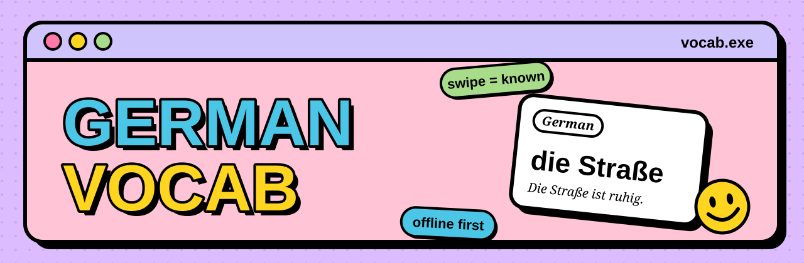
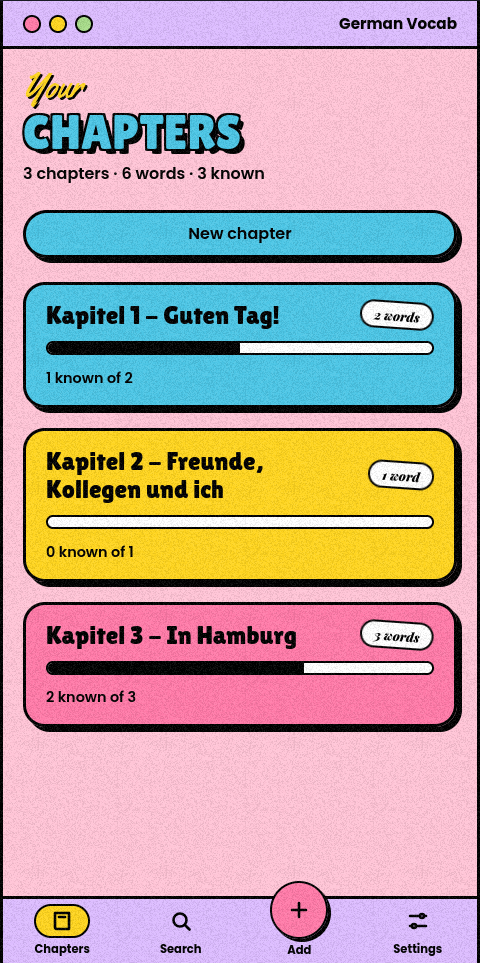
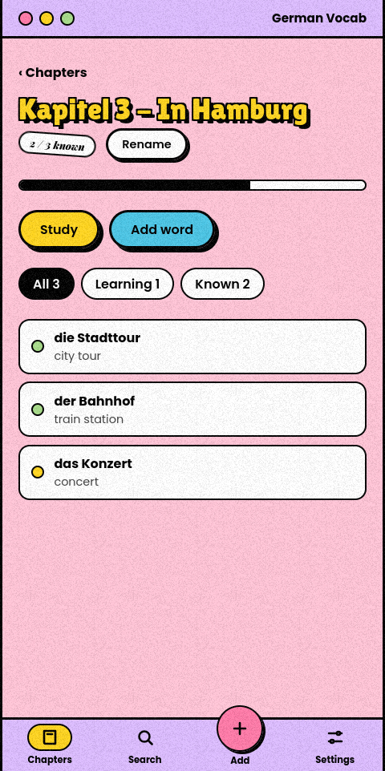
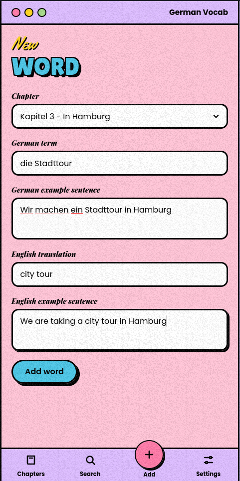
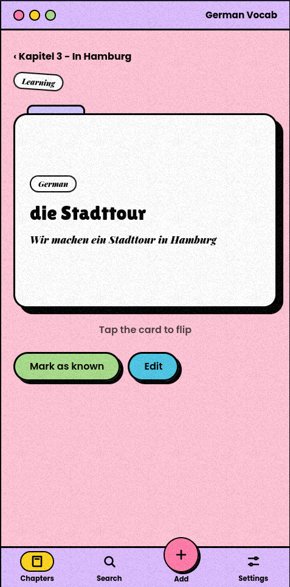
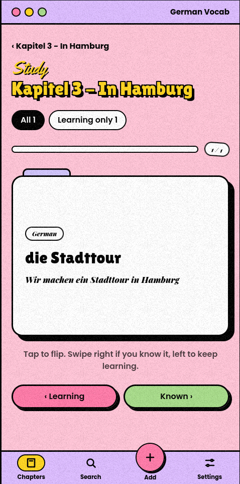
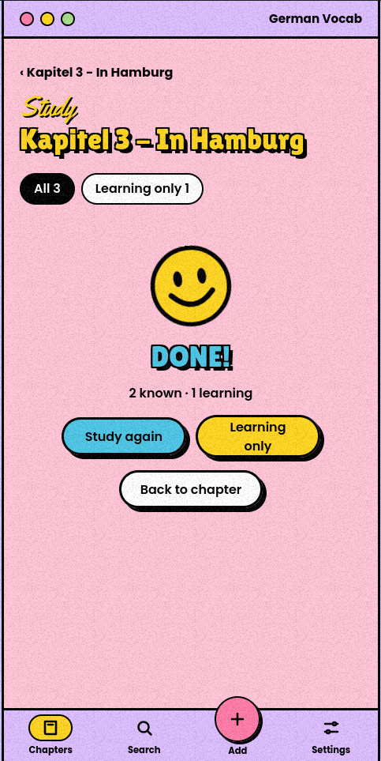
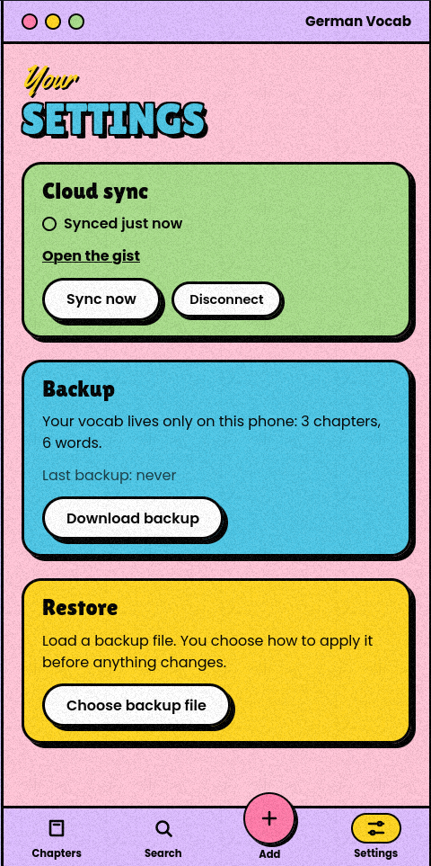
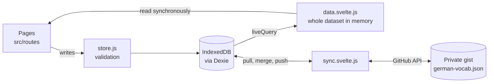

<p align="center">
  
</p>

<p align="center">
  <b>A pocket flashcard app for German vocabulary.</b><br />
  Built for the iPhone, works offline, swipe to learn, synced to a private GitHub gist.
</p>

<p align="center">
  <a href="https://arsalan9702.github.io/german-vocab/"><b>Open the app</b></a>
  &nbsp;·&nbsp;
  <a href="#features">Features</a>
  &nbsp;·&nbsp;
  <a href="#how-it-works">How it works</a>
  &nbsp;·&nbsp;
  <a href="#run-it-locally">Run it locally</a>
</p>

<p align="center">
  <a href="https://github.com/arsalan9702/german-vocab/actions/workflows/deploy.yml"></a>
  
  
  
  
  
</p>

---

## Screenshots

<table>
  <tr>
    <td align="center" width="33%">
      <br />
      <sub><b>Chapters</b><br />Every chapter with its word count and a progress bar of what you already know.</sub>
    </td>
    <td align="center" width="33%">
      <br />
      <sub><b>Chapter detail</b><br />All words in the order you added them, filterable by learning or known.</sub>
    </td>
    <td align="center" width="33%">
      <br />
      <sub><b>Add a word</b><br />German term, English meaning and example sentences, with a duplicate warning.</sub>
    </td>
  </tr>
  <tr>
    <td align="center">
      <br />
      <sub><b>Flashcard</b><br />Tap to flip between German and English. Mark it known in one tap.</sub>
    </td>
    <td align="center">
      <br />
      <sub><b>Study</b><br />Swipe right if you know it, left to keep learning. Every session is shuffled.</sub>
    </td>
    <td align="center">
      <br />
      <sub><b>Session done</b><br />How many you knew, how many to keep practising, and one tap to go again.</sub>
    </td>
  </tr>
  <tr>
    <td align="center">
      <br />
      <sub><b>Settings</b><br />Cloud sync to a private gist, plus JSON backup and restore.</sub>
    </td>
  </tr>
</table>

---

## Features

**Learn**

- **Study mode.** Swipe right for *known*, left for *learning*. Buttons and arrow keys do the same.
- **Shuffled every time.** Card order never becomes a memory cue.
- **Learning only.** Drill just the words you don't know yet.
- **Flip cards.** German on the front, English on the back, each with an example sentence.

**Organise**

- **Chapters** in the order you created them, with live progress bars.
- **Words** with a German term, English translation and an example sentence in each language.
- **Duplicate warning** when a German term already exists anywhere in your vocab.
- **Nothing gets deleted.** Chapters and words can be edited, never removed, so a slip of the thumb can't lose work.

**Keep it safe**

- **Offline first.** Everything lives in IndexedDB on the phone and works without a connection.
- **Cloud sync.** An optional copy in a private GitHub gist, updated a few seconds after every change.
- **Backup and restore.** Export to JSON. Import by *merge* (newer edit wins) or *replace all*, which downloads a backup of your current data first.

---

## Design

<table>
  <tr>
    <td></td><td><code>#d0c4fc</code> lavender</td>
    <td></td><td><code>#ffc4d6</code> pink</td>
    <td></td><td><code>#4cc6e6</code> cyan</td>
  </tr>
  <tr>
    <td></td><td><code>#ffd51f</code> yellow</td>
    <td></td><td><code>#ff7aa8</code> hot pink</td>
    <td></td><td><code>#a8dc8a</code> green</td>
  </tr>
</table>

- **Type:** Lilita One for display, Yellowtail for script, Playfair Display Black Italic for tags, Poppins for UI. All self-hosted through Fontsource.
- **Shadows:** hard offsets only, never a blur.
- **Motion:** only `transform` and `opacity` animate, so the phone's compositor does the work.
- **Grain:** a tiled 128 px PNG generated by `scripts/make-grain.mjs`.

---

## How it works



- **One write path.** Every change goes through `src/lib/store.js`, which validates input and throws a `ValidationError` that names the field.
- **Instant pages.** `src/lib/data.svelte.js` keeps the whole dataset in memory through a Dexie `liveQuery`. Pages read it synchronously, so they are complete on their first frame.
- **Hash routing.** `#/chapter/:id` and friends, because GitHub Pages has no SPA fallback. The router also runs the page slide animation.
- **Sync.** Each sync pulls the gist, merges it by id (the newer `updatedAt` wins), and pushes back only if something changed. It runs when the app opens, when it is hidden or shown again, when the connection returns, and 3 seconds after any write. Nothing is ever deleted, so merging both ways is safe.

### Setting up cloud sync

1. Open **Settings → Cloud sync** and tap **Create a GitHub token**. The `gist` scope is already ticked.
2. Paste the token and tap **Connect**. The app finds your existing gist or creates a new private one.
3. To use another browser or device, connect the same token there and your words come along.

The token is stored only on the device, and its `gist` scope can't reach anything else in your account.

---

## Run it locally

Requires Node 22.

```sh
npm install
npm run dev        # dev server, reachable from your phone on the LAN
```

| Script | What it does |
| --- | --- |
| `npm run dev` | Vite dev server with `--host`, so you can open it on your phone |
| `npm run build` | Production build into `dist/` |
| `npm run preview` | Serves `dist/` with `--host` |
| `npm run grain` | Regenerates the grain texture |

Open `http://<your-computer-ip>:5173` on the iPhone. The dev and preview servers send `Cache-Control: no-store`, so Safari never runs a stale build.

## Deploy

Every push to `main` builds the app and publishes it to GitHub Pages through `.github/workflows/deploy.yml`. In the repository settings, **Pages → Source** must be set to **GitHub Actions**.

---

## Project structure

```
german-vocab/
├── .github/workflows/deploy.yml   build and publish to GitHub Pages
├── docs/                          banner and README screenshots
├── public/                        static files copied as-is
├── scripts/make-grain.mjs         generates src/assets/grain.png
└── src/
    ├── main.js                    fonts, styles, persistence request, sync start, mount
    ├── App.svelte                 shell, top bar, routes, tab bar
    ├── app.css                    tokens, base, buttons, cards, flashcard
    ├── screens.css                layout and per-screen styles
    ├── components/                Flashcard, TabBar, ChapterDialog, Toasts, Smiley
    ├── routes/                    Chapters, Chapter, WordView, WordForm, Study, Settings, Placeholder
    └── lib/
        ├── db.js                  Dexie schema
        ├── store.js               all writes, validation, backup format
        ├── data.svelte.js         in-memory dataset via liveQuery
        ├── sync.svelte.js         GitHub gist sync
        ├── router.svelte.js       hash router and page transitions
        └── portal.js, toast.svelte.js, ids.js, text.js
```

---

## Notes from building it on iOS Safari

Two lessons that cost real debugging time:

- **Swiping needs touch events.** Safari cancels pointer events the moment it decides a drag is a page pan. The study card listens to `touchmove` with `{ passive: false }` and calls `preventDefault()` once a drag is clearly horizontal. Mouse input still uses pointer events.
- **If a fix seems to do nothing, check the cache.** Without explicit cache headers, Safari can keep serving an old `index.html` for a long time. Clearing Safari's website data, or sending `no-store` in development, rules that out.

---

## Roadmap

- [x] Chapters, words, add and edit
- [x] Flashcards and study mode with swipe and shuffle
- [x] Backup and restore
- [x] GitHub gist sync
- [x] GitHub Pages deploy
- [ ] Fuzzy search across all chapters (Fuse.js, umlauts ignored)
- [ ] Home-screen app (PWA)

---

<p align="center">
  <sub>Made for learning German, one swipe at a time.</sub>
</p>
